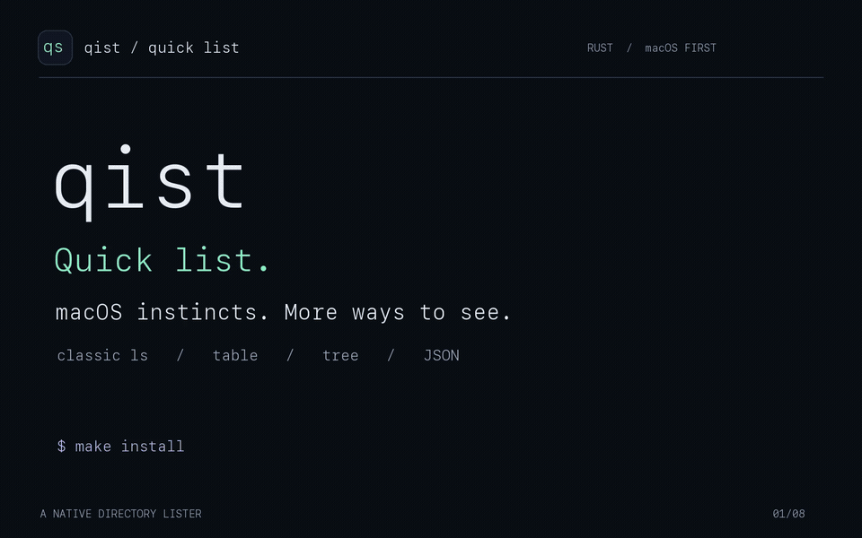

# qist

**Quick list. Familiar macOS behavior, more ways to see your files.**

A native Rust directory lister for macOS and Linux. Use **`qs`** for classic
`ls` listings, readable metadata tables, directory trees, and structured JSON.
Colors follow your terminal palette. macOS compatibility comes first.

[](docs/assets/qist-demo.mp4)

[Watch the full demo (MP4)](docs/assets/qist-demo.mp4) ·
[Usage guide](GUIDE.md) · [Compatibility](docs/COMPATIBILITY.md) ·
[Benchmarks](docs/BENCHMARKS.md) · [Rebuild the demo](docs/DEMO.md)

The demo uses captured output from `qs 0.2.0` and measured benchmark results.
Typing and chart animations are presentation effects; they do not represent
execution time. The animated preview plays inline on GitHub; the MP4 is linked
for full-resolution playback.

## Install

Requires **Rust 1.88+**, a C linker, Make, and Python 3. Install Rust with
[rustup](https://rust-lang.org/tools/install/). On macOS, install Apple's Command
Line Tools with `xcode-select --install` if they are missing.

From this repository's root:

```sh
make install
source ~/.zshrc
qs --version
qs --table -h
```

This builds a release binary at **`~/.softwares/bin/qs`**, adds the directory to
`~/.zshrc` PATH, and backs up the shell file before changing it. Reinstalling is
idempotent. No `sudo` is needed. `/bin/ls` and your aliases are left intact.

For another location, use `make install PREFIX="$HOME/.local"`.
For Cargo installation without shell-file edits, use
`cargo install --path . --locked`. Linux and other shells are covered in the
[setup guide](GUIDE.md#setup).

## See your directory your way

```sh
qs                                  # columns in a terminal; lines in a pipe
qs -lah                             # familiar long listing with hidden files
qs --table -h                       # readable metadata table
qs --tree --depth=2                  # a directory tree, including counts
qs --json -R --depth=2               # one JSON document with nested entries
qs -l@eO                            # macOS attributes, ACLs, and BSD flags
qs --sort=version                    # file2 before file10
qs --group-directories-first --ignore='*.tmp'
```

Use options **before paths**, as with macOS `ls`: `qs --table -h src`.
Table and tree modes escape control characters by default. JSON includes raw
filename bytes and stays free of terminal escape codes. Unicode icons and
clickable terminal links are opt-in.

## Make it yours

```sh
qs --init-config
```

Edit `~/.config/qist/config.toml` (or `$XDG_CONFIG_HOME/qist/config.toml`):

```toml
default_output = "table"  # auto | single | columns | across | commas | long | json | table | tree
color = "auto"
human_readable = true
group_directories_first = true
icons = false

[colors]
directory = "1;34"         # your terminal's bold blue
symlink = "36"
executable = "32"
```

Command-line output flags override the default mode. `--no-config` uses built-in
defaults. `--print-config` shows the loaded configuration. See the
[complete configuration reference](GUIDE.md#configuration) and
[annotated example](config.example.toml).

## Measured speed

On an **Apple M3**, macOS 27.0.1, local temporary files, warm cache, release build,
31 alternating runs per command, `LC_ALL=C`, output discarded:

| 20,000 empty files | `qs` median | `/bin/ls` median | `ls` time ÷ `qs` time |
| --- | ---: | ---: | ---: |
| Sorted names · `-1` | 19.118 ms | 35.460 ms | 1.85× |
| Numeric details · `-ln` | 127.315 ms | 146.491 ms | 1.15× |
| Unsorted names · `-1f` | 13.090 ms | 25.005 ms | 1.91× |

**Small directories favor `ls` in this run.** With 100 files, sorted names took
3.419 ms in `qs` versus 2.600 ms in `ls`. Launch overhead matters. These are local
measurements, not a promise for every disk, directory, locale, or output mode.
JSON, table, and tree are not compared to classic `ls` output.

The harness first checks that output matches, then times equivalent commands.
[Methodology, both fixture sizes, and raw samples](docs/BENCHMARKS.md).

## macOS compatibility

The latest saved local run passes **236/236 fixture comparisons** with `/bin/ls`:
233 byte-for-byte output/status cases and 3 terminal-color cases. All documented
macOS short-option letters are implemented. This finite suite does **not** prove
universal 100% compatibility.

Actual iCloud dataless files, whiteouts, firmlinks, and network-filesystem races
still need live coverage. Historical `COMMAND_MODE=legacy` / `COMPAT_MODE`
emulation is absent. Configurable defaults and automatic colors are intentional
additions. Exact diagnostic wording is not guaranteed.

The host dialect is the default: BSD on macOS and GNU on Linux.
`--compat=bsd` or `--compat=gnu` makes conflicting short flags explicit. See the
[full compatibility matrix and limits](docs/COMPATIBILITY.md). Linux has CI
coverage configured; local validation was cross-compilation, not a Linux runtime
parity claim.

## Under the hood

Names-only listings use buffered libc `readdir` without per-file metadata reads
unless the requested options need them. On macOS, `getattrlistbulk` batches
regular-file metadata in 128 KiB buffers, with `fstatat` fallbacks where needed.
Linux uses descriptor-relative `fstatat` and requests `statx` birth times when
needed. Ownership lookup is cached; output is buffered; C-locale sorting uses a
direct byte comparison. Listings never delegate to `ls`, `stat`, or a shell.

## Develop and reproduce

```sh
make check
make test
make build
make parity       # macOS only; results in target/macos-parity.json
make benchmark    # 20,000 files; results in target/benchmark.json
```

The [guide](GUIDE.md) covers all option families, scripting, JSON fields,
troubleshooting, updating, and uninstalling. The [demo guide](docs/DEMO.md) covers
video regeneration and GitHub presentation. MIT licensed; see [LICENSE](LICENSE).
